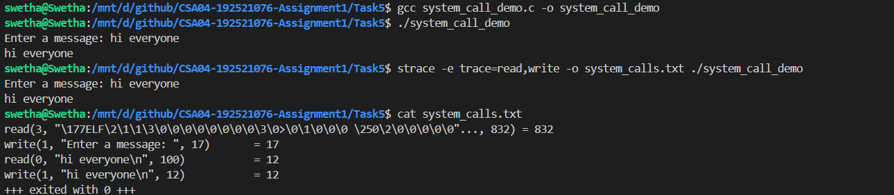
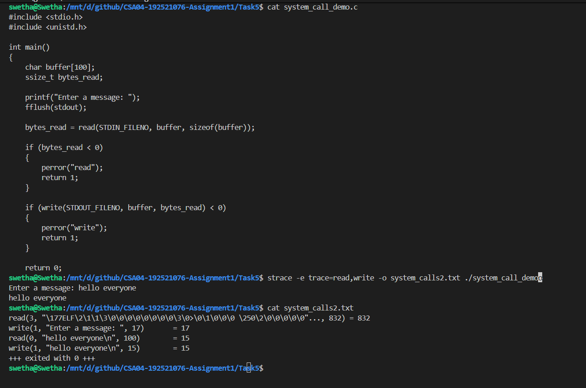

# Task 5 – Evaluate and Demonstrate System Calls

## 1. Introduction

A system call is a mechanism through which a user-level program requests a service from the operating system kernel. Applications cannot directly perform privileged operations or access protected hardware resources. Instead, they use system calls to request services such as file access, process creation, memory management, and communication.

System calls act as an interface between user applications and the operating system. They help maintain security by ensuring that requests for protected resources are handled by the kernel.

## 2. Categories of System Calls

| Category | Purpose | Examples |
|---|---|---|
| Process Control | Creates, executes, and terminates processes. | `fork()`, `exec()`, `wait()`, `exit()` |
| File Management | Creates, opens, reads, writes, and closes files. | `open()`, `read()`, `write()`, `close()` |
| Device Management | Requests access to and controls devices. | `ioctl()`, `read()`, `write()` |
| Information Maintenance | Retrieves or modifies system and process information. | `getpid()`, `time()`, `uname()` |
| Communication | Allows processes to exchange information. | `pipe()`, `socket()`, `send()`, `recv()` |
| Protection | Controls permissions and access to resources. | `chmod()`, `chown()`, `setuid()` |

These categories allow application programs to use operating-system services without directly controlling hardware or privileged resources.

## 3. Internal Working of the `read()` System Call

The `read()` system call reads data from a file descriptor into a memory buffer.

Its general syntax is:

```c
ssize_t read(int fd, void *buffer, size_t count);
```

The parameters are:

- `fd`: File descriptor identifying the input source.
- `buffer`: Memory location where the received data is stored.
- `count`: Maximum number of bytes to read.

### Steps involved in executing `read()`

1. A user program calls `read()` through its C library interface.
2. The library prepares the system-call number and required arguments.
3. A system-call instruction transfers execution from user mode to kernel mode.
4. The kernel identifies the requested system call and validates its arguments.
5. The kernel performs the requested read operation using the appropriate file or device subsystem.
6. The result, such as the number of bytes read or an error, is returned.
7. Execution switches back to user mode, and the application continues.

### System-call execution flow

```text
User Application
       |
       v
  read(fd, buffer, count)
       |
       v
 C Library Interface
       |
       v
 System Call Instruction
       |
       v
    Kernel Mode
       |
       v
 Validate Arguments
       |
       v
 Perform Read Operation
       |
       v
 Return Result
       |
       v
    User Mode
       |
       v
 Application Continues
```

A system call involves a controlled transition between user mode and kernel mode. The actual time taken also depends on the requested operation, device activity, scheduling, and other system conditions.

## 4. Methods of Passing System-Call Parameters

The operating system needs the system-call number and its arguments to identify and execute a requested operation.

Three common parameter-passing methods are:

### 4.1 Passing Parameters Through Registers

Arguments are placed directly into CPU registers before executing the system-call instruction.

- Fast for a small number of arguments.
- Limited by the number of available registers.
- Commonly used by modern processor architectures.

### 4.2 Passing Parameters Through a Memory Block

The application places the arguments in a memory block and passes the address of that block through a register.

- Supports a larger number of arguments.
- Avoids requiring every argument to occupy a separate register.
- Requires the kernel to access and validate the supplied memory.

### 4.3 Passing Parameters Through the Stack

Arguments are placed on the program stack, from where the system-call interface can retrieve them.

- Provides an organized way to store arguments.
- Can be useful when several parameters must be passed.
- The exact implementation depends on the processor architecture and calling convention.

The method used depends on the operating system and hardware architecture.

## 5. Practical Demonstration Using Linux

The following C program uses the `read()` and `write()` system calls to receive input from the keyboard and display it on the terminal.

### Source Code – `system_call_demo.c`

```c
#include <stdio.h>
#include <unistd.h>

int main()
{
    char buffer[100];
    ssize_t bytes_read;

    printf("Enter a message: ");
    fflush(stdout);

    bytes_read = read(STDIN_FILENO, buffer, sizeof(buffer));

    if (bytes_read < 0)
    {
        perror("read");
        return 1;
    }

    if (write(STDOUT_FILENO, buffer, bytes_read) < 0)
    {
        perror("write");
        return 1;
    }

    return 0;
}
```

### Compilation

```bash
gcc system_call_demo.c -o system_call_demo
```

### Normal Execution

```bash
./system_call_demo
```

Enter a message and press Enter. The program reads the input and writes it back to the terminal.

### Observe System Calls Using `strace`

```bash
strace -e trace=read,write ./system_call_demo
```

This command displays the `read()` and `write()` system calls made by the program.

You can also save the trace:

```bash
strace -e trace=read,write -o system_calls.txt ./system_call_demo
```

View the captured output:

```bash
cat system_calls.txt
```

**Expected observation:** The trace should show a `write()` operation for the prompt, a `read()` operation for keyboard input, and a `write()` operation for displaying the received message. Additional calls may appear depending on the program's runtime environment.

The actual trace should be captured from your own Linux environment and included as evidence.

## 6. Alternative Evaluation – C Library Functions vs Direct System Calls

C programs can perform file operations using standard library functions or by directly invoking system calls.

| Comparison Factor | C Library Functions | Direct System Calls |
|---|---|---|
| Examples | `fopen()`, `fread()`, `fwrite()`, `fclose()` | `open()`, `read()`, `write()`, `close()` |
| Interface | Higher-level and easier to use. | Lower-level interface. |
| Buffering | Standard I/O functions can use user-space buffering. | `read()` and `write()` operate directly through the kernel interface. |
| System-call Frequency | Buffering can reduce the number of system calls. | Each explicit `read()` or `write()` normally makes a system-call request. |
| Control | Provides convenient file-handling operations. | Gives the programmer more direct control over file operations. |

### Evaluation of System-Call Count

Consider a program that reads a file containing `N` bytes.

If the program uses direct `read()` calls with a buffer of size `B`, the approximate number of read operations is:

\[
\text{Read calls} \approx \left\lceil \frac{N}{B} \right\rceil
\]

An additional call may occur when the program checks for end-of-file, depending on how the reading loop is implemented.

With standard I/O functions such as `fread()`, the C library can read a larger block into a user-space buffer and satisfy multiple application-level read requests from that buffer. This can reduce the number of system calls.

For example, if a program reads a 1 MB file using a 4 KB buffer, direct reads require approximately 256 successful read operations, excluding any additional end-of-file check.

### Evaluation

Standard C library functions are convenient and can improve performance by reducing system-call frequency through buffering. Direct system calls provide greater control over low-level file operations but require careful handling of partial reads, errors, and buffer management.

For ordinary application development, buffered library functions are often suitable. Direct system calls are useful when precise control over I/O behaviour is required.

## 7. Conclusion

System calls provide the interface between user applications and the operating-system kernel. They allow applications to request services such as file operations, process control, communication, and protection.

The `read()` demonstration shows how an application requests data through a system call and how Linux can expose this activity using `strace`. Parameter-passing methods help transfer system-call arguments to the kernel, while C library functions provide convenient interfaces and buffering.

Understanding system calls is important in a smart hospital because applications must interact safely and efficiently with storage devices, sensors, networks, and other operating-system resources.

### Actual Execution Results

The program was compiled and executed successfully using GCC in Ubuntu on WSL. The `strace` utility was used to observe the system calls generated during execution.

The program was tested with the input `hello everyone`.

**Observed system calls:**

| System Call | Observed Result | Explanation |
|---|---|---|
| `read(3, ..., 832)` | 832 bytes read | Runtime loader accessed executable or library data. |
| `write(1, ..., 17)` | 17 bytes written | Displayed the input prompt. |
| `read(0, ..., 100)` | 15 bytes read | Received keyboard input, including the newline character. |
| `write(1, ..., 15)` | 15 bytes written | Displayed the received message. |

The program terminated with exit status `0`, indicating successful execution.

**Observation:** The trace demonstrates the transition between application-level operations and kernel services. The program uses `read()` to receive input and `write()` to display the received data. The file descriptor values identify the input and output streams used by the program.
## 8. Practical Evidence

### Program Execution


### System Call Trace
