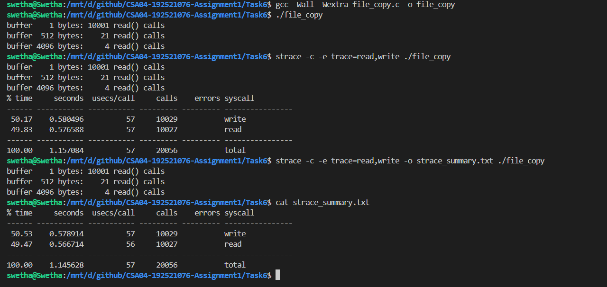

# Task 6 – Evaluate the Cost of System Calls

## 1. Introduction

System calls allow user applications to request services from the operating-system kernel. However, a system call generally involves more overhead than an ordinary function call because execution must transition from user mode to kernel mode and back.

When a program copies a file, the number of system calls depends on how much data is transferred during each operation. Choosing an appropriate buffer size can reduce the number of system calls and improve performance.

This experiment evaluates the effect of different buffer sizes on file-copy operations using the `read()` and `write()` system calls.

## 2. Why System Calls Are Expensive

An ordinary function call generally transfers control within the same process and execution mode. A system call requires additional operating-system operations.

The overhead includes:

- Switching execution from user mode to kernel mode.
- Identifying and validating the requested operation.
- Checking file descriptors and access permissions.
- Performing the requested kernel operation.
- Returning the result and switching back to user mode.

System calls can also involve waiting for I/O operations, scheduling, and data movement. Therefore, their actual cost depends on the operation and system conditions.

Reducing unnecessary system calls can improve performance, particularly when a program performs many small I/O operations.

## 3. Effect of Buffer Size on System Calls

A buffer is a temporary memory area used to hold data while it is transferred between a file and an application.

The assignment uses a 10,000-byte file and tests three buffer sizes:

- 1 byte
- 512 bytes
- 4096 bytes

The approximate number of successful read operations is:

\[
\text{Successful reads} = \left\lceil \frac{N}{B} \right\rceil
\]

Where:

- \(N\) = file size in bytes.
- \(B\) = buffer size in bytes.

The program also makes one additional `read()` call to detect the end of the file.

Therefore:

\[
\text{Total read calls} =
\left\lceil \frac{N}{B} \right\rceil + 1
\]

For a 10,000-byte file:

| Buffer Size | Successful Reads | EOF Check | Total Read Calls |
|---:|---:|---:|---:|
| 1 byte | 10,000 | 1 | 10,001 |
| 512 bytes | 20 | 1 | 21 |
| 4096 bytes | 3 | 1 | 4 |

A larger buffer reduces the number of read operations because more data is transferred per call.

The same principle applies to write operations. In this program, the number of successful write calls is normally 10,000, 20, and 3 respectively, assuming each write completes the requested amount.

## 4. Practical Implementation Using `read()` and `write()`

The C program `file_copy.c` creates a 10,000-byte test file named `records.dat`. It copies the file using three different buffer sizes and counts the number of `read()` calls.

The program uses:

- `open()` to open the source and destination files.
- `read()` to obtain data from the source.
- `write()` to copy the data to the destination.
- `close()` to close the file descriptors.
- `unlink()` to remove the temporary files.

The `read()` call count includes the final call that returns zero at the end of the file.

### Compilation

```bash
gcc -Wall -Wextra file_copy.c -o file_copy
```

### Execution

```bash
./file_copy
```

### Expected Output

```text
buffer    1 bytes: 10001 read() calls
buffer  512 bytes:    21 read() calls
buffer 4096 bytes:     4 read() calls
```

These are the expected results for the supplied 10,000-byte test file.

## 5. Measuring System Calls Using `strace`

The `strace` utility can summarize the system calls made by a program.

Execute:

```bash
strace -c -e trace=read,write ./file_copy
```

The summary reports:

- Number of calls to `read()` and `write()`.
- Time spent in the traced system calls.
- Average time per call.
- Percentage of traced system-call time spent on each operation.

The program's own output reports the number of `read()` calls for each buffer size. The `strace` summary reports calls made by the entire process, including runtime and file-handling activity. Therefore, its aggregate count will not necessarily equal one of the individual program counters.

The smaller buffer produces many more system calls, while larger buffers reduce the number of operations.

### Saving the Trace Summary

```bash
strace -c -e trace=read,write -o strace_summary.txt ./file_copy
```

To inspect the saved summary:

```bash
cat strace_summary.txt
```

## 6. Effect of Library Buffering

Instead of directly using `read()` and `write()`, a program can use standard C library functions such as:

- `fopen()`
- `fread()`
- `fwrite()`
- `fclose()`

These functions can use user-space buffers to collect data before making system calls.

For example, when reading a file of \(N\) bytes using a library buffer of approximately 4096 bytes, the number of underlying read operations can be approximately:

\[
\frac{N}{4096}
\]

In comparison, direct system calls using a buffer of \(B\) bytes require approximately:

\[
\left\lceil \frac{N}{B} \right\rceil
\]

successful read operations, plus an additional end-of-file check in a typical reading loop.

**Evaluation:** Library buffering reduces the number of kernel transitions when an application performs many small reads or writes. However, it uses additional user-space memory for its buffers and introduces library-level buffering behaviour.

## 7. Alternative Evaluation – Memory-Mapped Files (`mmap`)

Another approach is to use memory-mapped files instead of repeatedly calling `read()` and `write()`.

The `mmap()` system call maps a file into a process's virtual address space. The program can then access file contents through memory addresses. A destination mapping can also be used to modify or copy file contents.

### Comparison

| Factor | Buffered `read()` / `write()` | Memory-Mapped Files |
|---|---|---|
| System Calls | Repeated calls depending on buffer size. | Mapping and unmapping require a smaller number of explicit system calls. |
| Data Access | Explicit transfer between a user buffer and the file interface. | File contents are accessed through mapped memory. |
| Copying | Usually involves copying data between user buffers and kernel-managed file pages. | Can avoid an extra explicit read into a separate user buffer, although page faults and copying may still occur. |
| Memory Usage | Requires a fixed-size application buffer. | Uses virtual address space for the mapping; resident memory depends on pages actually accessed. |
| Large Files | Can process files in fixed-size chunks. | Can map large files or map them in sections, subject to address-space and system limits. |

### Evaluation

Memory mapping can reduce repeated explicit read and write system calls and can be useful for workloads involving frequent access to file contents.

However, it does not eliminate all overhead. Page faults, storage I/O, synchronization, and writing modified pages back to storage still require operating-system work.

For very large files, mapping the entire file may consume substantial virtual address space and may increase memory pressure as pages are accessed. Mapping smaller sections can help control resource usage.

## 8. Complexity Analysis

Let \(N\) be the file size and \(B\) the buffer size.

| Operation | Time Complexity | Extra Application Buffer Space |
|---|---|---|
| Buffered `read()` / `write()` | \(O(N)\) | \(O(B)\) |
| Library-buffered I/O | \(O(N)\) | \(O(B)\) for its buffer |
| Memory-mapped file copy | \(O(N)\) data processing | Depends on mapping and pages resident in memory |

All approaches must process the file's data, so their overall data-processing complexity is linear in the file size. Their practical performance differs because of system-call overhead, buffering, memory management, and I/O behaviour.

## 9. Evaluation and Recommendation

The experiment demonstrates that buffer size has a major effect on the number of system calls.

For the 10,000-byte test file:

- A 1-byte buffer requires 10,001 read calls.
- A 512-byte buffer requires 21 read calls.
- A 4096-byte buffer requires only 4 read calls.

The 4096-byte buffer is the best choice among the three tested sizes in terms of reducing read-system-call frequency. It is therefore a reasonable starting point for the hospital's backup program.

However, the final choice should also consider measured execution time, memory availability, storage performance, and workload characteristics. A larger buffer may reduce system calls further, but it also uses more memory and does not guarantee proportionally faster execution.

## 10. Conclusion

System calls introduce overhead because they require controlled transitions between user mode and kernel mode. The file-copy experiment demonstrates that using larger buffers can significantly reduce the number of read and write operations.

Library buffering provides another way to reduce system-call frequency, while memory-mapped files offer an alternative for accessing file contents through virtual memory.

Based on the three tested buffer sizes, 4096 bytes is the most efficient choice in terms of read-call count. The final recommendation should be supported by the actual execution-time and system-call measurements collected from Linux.

## 11. Actual Experimental Results

The program was compiled using GCC in Ubuntu on WSL and executed successfully.

### 11.1 Program-Level Read Counts

| Buffer Size | Expected Read Calls | Actual Read Calls | Result |
|---:|---:|---:|---|
| 1 byte | 10,001 | 10,001 | Pass |
| 512 bytes | 21 | 21 | Pass |
| 4096 bytes | 4 | 4 | Pass |

All three results matched the expected values.

### 11.2 System-Call Measurements Using `strace`

The following measurements were obtained using:

```bash
strace -c -e trace=read,write ./file_copy
```

| System Call | Number of Calls | Time (seconds) | Average Time (µs/call) |
|---|---:|---:|---:|
| `write` | 10,029 | 0.578914 | 57 |
| `read` | 10,027 | 0.566714 | 56 |
| Total | 20,056 | 1.145628 | 57 |

The `strace` summary includes system calls made during the entire program execution, including runtime and file-handling activity. Therefore, its aggregate read count is different from the sum of the three individual program-level read counts.

The reported system-call time is not the total wall-clock execution time.

### 11.3 Analysis

The experiment demonstrates that buffer size has a significant effect on system-call frequency. The 1-byte buffer required 10,001 read calls, whereas the 4096-byte buffer required only 4.

This reduction occurs because larger buffers transfer more data during each read operation. Consequently, fewer transitions between user mode and kernel mode are required.

Among the tested buffer sizes, 4096 bytes was the most efficient in terms of reducing read-system-call frequency. However, actual execution performance must also consider memory usage, storage behaviour, and elapsed time.

## 12. Practical Evidence

### Program Execution and System-Call Measurements



### Saved Measurement Output

The `strace` summary is also available in `strace_summary.txt`.