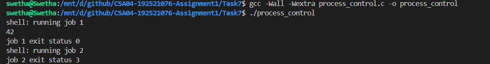
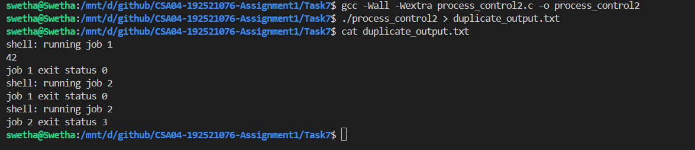

# Task 7 – Process Control Using System Calls

## 1. Aim

To understand process control in an operating system using the `fork()`, `exec()`, `waitpid()`, `exit()`, and `_exit()` system calls. The experiment demonstrates how a parent process creates child processes, executes commands, waits for their completion, and retrieves their exit statuses.

## 2. Concepts

### 2.1 fork()

The `fork()` system call creates a new child process by duplicating the calling process. It returns:
- `0` to the child process.
- The child's process ID to the parent process.
- `-1` if process creation fails.

### 2.2 exec()

The `exec()` family of functions replaces the current process image with a new program. In this experiment, `execlp()` executes the `expr` command to calculate `6 * 7`.

If `execlp()` succeeds, it does not return. If it fails, the program prints an error and terminates with status `127`.

### 2.3 waitpid()

The `waitpid()` system call makes the parent wait for a specific child process to finish. It also collects the child's termination status.

### 2.4 exit() and _exit()

- `exit()` terminates a process after flushing standard I/O buffers and performing normal termination handling.
- `_exit()` terminates a process immediately without flushing standard I/O buffers.

### 2.5 Zombie and Orphan Processes

- **Zombie process:** A child that has terminated but whose parent has not yet collected its exit status using `wait()` or `waitpid()`.
- **Orphan process:** A child whose parent terminates before it does. The child is subsequently adopted by a system process.

## 3. Experiment 1 – Creating and Executing Child Processes

### Program: `process_control.c`

The program creates a child process using `fork()`. The child executes the `expr` command using `execlp()` to calculate `6 * 7`. The parent waits for the child using `waitpid()` and displays its exit status.

A second child process is created and terminated using `_exit(3)`. The parent collects and displays its exit status.

### Program Execution

```bash
gcc -Wall -Wextra process_control.c -o process_control
./process_control
```

### Output

```text
shell: running job 1
42
job 1 exit status 0
shell: running job 2
job 2 exit status 3
```

### Explanation

1. The parent process displays the first job message.
2. `fork()` creates the first child process.
3. The child executes `expr 6 * 7` using `execlp()`.
4. The command calculates and displays `42`.
5. The parent waits for the child and displays exit status `0`, indicating successful execution.
6. The parent creates a second child process.
7. The second child terminates using `_exit(3)`.
8. The parent collects and displays exit status `3`.

### Why is fflush(stdout) used before fork()?

The `fflush(stdout)` call flushes any pending output before creating a child process. This prevents the child from inheriting an already buffered copy of the parent's output and printing it again during termination.

## 4. Experiment 2 – Demonstrating Buffered Output Duplication

### Program: `process_control2.c`

The second program is a modified version of the first experiment.

The following changes are made:

- The second `fflush(stdout)` call, before the second `fork()`, is removed.
- `_exit(3)` is replaced with `exit(3)`.
- The program's output is redirected to a file.

### Program Execution

```bash
gcc -Wall -Wextra process_control2.c -o process_control2
./process_control2 > duplicate_output.txt
cat duplicate_output.txt
```

### Actual Output

```text
shell: running job 1
42
job 1 exit status 0
shell: running job 2
job 1 exit status 0
shell: running job 2
job 2 exit status 3
```

### Explanation of Output Duplication

When standard output is redirected to a file, it is generally fully buffered. This means printed output may remain in the buffer instead of being written immediately.

In the second experiment:

1. The parent prints `job 1 exit status 0`. Since stdout is redirected, this output remains buffered.
2. The parent prints `shell: running job 2`, which also remains in the buffer.
3. The parent calls `fork()`, creating a child with a copy of the parent's buffered output.
4. The child calls `exit(3)`. The `exit()` function flushes the child's copy of the buffered output.
5. The parent later terminates and flushes its own copy of the same buffered output.

As a result, both buffered lines appear twice in the output file.

This demonstrates why flushing standard output before calling `fork()` is important when buffered output must not be duplicated.

## 5. Difference Between exit() and _exit()

| Feature | exit() | _exit() |
|---|---|---|
| Flushes standard I/O buffers | Yes | No |
| Performs normal C library termination handling | Yes | No |
| Terminates the process | Yes | Yes |
| Used in the experiment | Second experiment | First experiment |

## 6. Process Creation and Command Execution

The process execution sequence is:

1. The parent process calls `fork()`.
2. The child process calls `execlp()` to execute the required command.
3. The operating system replaces the child's process image with the new program.
4. The parent waits using `waitpid()`.
5. The parent retrieves and displays the child's exit status.

The combination of `fork()` and `exec()` allows a shell-like program to create a separate process and execute an external command while retaining the parent process.

## 7. Alternative Approaches

### posix_spawn()

`posix_spawn()` provides an alternative to the traditional `fork()` followed by `exec()` approach. It creates a new process and executes a specified program through a single interface.

It can simplify process creation when a separate child process is needed only to execute another program.

### Threads

Threads are another alternative for concurrent execution within a process. They share the same address space and resources, unlike separate processes.

However, threads do not provide the same degree of memory isolation as separate processes. A fault in one thread can affect the entire process.

For executing external commands independently, process creation using `fork()` and `exec()` provides better isolation.

## 8. Complexity and Resource Considerations

- Process creation requires operating-system resources such as process control structures and memory-management information.
- `fork()` commonly uses copy-on-write, so memory pages are not necessarily copied immediately.
- `exec()` replaces the existing process image with the new program.
- `waitpid()` allows the parent to collect the child's termination status and prevents terminated children from remaining as unreaped zombies.
- Process creation and execution have overhead compared with executing a function within the same process.

The actual resource cost depends on the operating system, process memory, and workload.

## 9. Conclusion

The experiment demonstrated process creation and management using `fork()`, `execlp()`, and `waitpid()`. The first experiment successfully executed the `expr` command and retrieved the exit statuses of two child processes.

The second experiment demonstrated how buffered output can be duplicated when `fork()` is used without flushing standard output. It also highlighted the difference between `exit()` and `_exit()`.

Thus, the experiment provided practical understanding of process creation, command execution, synchronization, exit-status handling, and standard I/O buffering in operating systems.

## 10. Practical Evidence

**### Experiment 1 – Program Execution**



**### Experiment 2 – Buffered Output Duplication**

